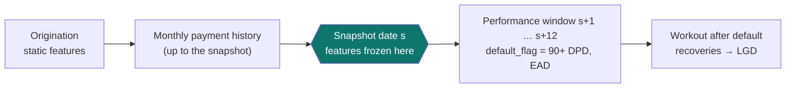

# Smart Loan Recovery: Leak-Free PD, LGD, EAD and Expected Loss

A credit-risk pipeline that estimates, for every performing loan:

- the **probability of default** in the next 12 months (PD);
- the **loss given default** (LGD);
- the **exposure at default** (EAD).

It combines them into **Expected Loss** and ranks loans into recovery-priority tiers. Everything is
evaluated **out of time**, on a later snapshot that no model saw.

[](https://github.com/charan-reddy-dev/Smart-Loan-Recovery-System-with-Machine-Learning-/actions/workflows/ci.yml)

> **Data:** synthetic. A loan book of 52,000 applicants is simulated month by month by
> [`src/data_pipeline.py`](src/data_pipeline.py) (seed 2027). No real borrower data is used, so the
> metrics below describe this simulated book, not a real lender's portfolio.

## The bug this replaces: a circular target

The previous version (kept in [`legacy/`](legacy/)) worked like this:

1. Cluster borrowers with K-Means.
2. Call two of the four clusters "high risk".
3. Train a Random Forest to predict that label from the **same ten features the clusters were built on**.

The model scored 93.5% accuracy because it was re-learning the clustering, a deterministic function of
its own inputs. It wasn't predicting default: the flagged group's write-off rate (41.9%) was *lower*
than the unflagged group's (45.6%). It also mixed post-default collection fields with pre-default
behaviour.

### How the circularity was removed



1. **The target is a future event, not a formula.** `default_flag = 1` if the loan reaches 90+ days past
   due (3 missed instalments) during the 12 months **after** the snapshot. The default is produced by a
   monthly arrears process driven partly by variables no model sees:
   - true credit quality;
   - a persistent idiosyncratic factor;
   - income shocks;
   - a shared macro factor.
2. **Every column has a declared timing.** The registry in `data_pipeline.COLUMNS` marks each column as
   `origination`, `snapshot`, `outcome` or `generator`. `assert_no_leakage()` refuses any model feature
   that isn't an origination or snapshot column.
3. **The future can be re-drawn without touching the past.** Each simulated month uses its own RNG stream,
   so `tests/test_data_pipeline.py` re-simulates every month after the snapshot. Every feature stays
   identical and the labels change. This is the direct test that no feature uses future information.
4. **Out-of-time split.**

   | Sample | Snapshot | Performance window | Loans | Defaults | 12-month default rate |
   |---|---|---|---|---|---|
   | Development | 2022-06 | 2022-07 … 2023-06 | 18,163 | 1,187 | 0.0654 |
   | Out-of-time (OOT) test | 2023-06 | 2023-07 … 2024-06 | 21,477 | 1,086 | 0.0506 |

   - The development window ends at the OOT snapshot, so no OOT outcome is used to fit, calibrate or
     select anything.
   - A loan performing at both dates appears in both samples, the standard multi-snapshot design. Its
     development label is necessarily 0.
5. **Shuffled-label control.** The selected pipeline was refitted 5 times on shuffled development labels.
   Its mean OOT ROC-AUC is **0.5055**; the draws were 0.5561, 0.5702, 0.4549, 0.4914 and 0.4548.
6. **No exact duplicates among features.** `current_balance` (= `balance_to_limit × credit_limit`) and
   `collateral_value` (= `credit_limit / ltv`) are kept for reporting but aren't model inputs.
   `remaining_term_months` (= `term_months − months_on_book`) was dropped. All three were removed after
   the first trial runs, because exact collinearity was splitting the logistic model's SHAP attributions
   across redundant columns. No other change was made after seeing results.

## Formulation

For loan *i* observed at snapshot *s*:

$$\mathrm{PD}_i = P(\text{90+ DPD in } (s, s+12] \mid x_i^{\le s})$$

$$\mathrm{LGD}_i = \operatorname{clip}_{[0,1]}\left(1 - \frac{\mathrm{PV}(\text{recoveries}_i) - \mathrm{PV}(\text{workout costs}_i)}{\mathrm{EAD}_i}\right)$$

$$\mathrm{EAD}_i = \text{balance in the default month} \;=\; \widehat{\text{EAD factor}}_i \times \text{exposure base}_i$$

$$\boxed{\;\mathrm{EL}_i = \mathrm{PD}_i \times \mathrm{LGD}_i \times \mathrm{EAD}_i\;}\qquad \mathrm{EL}_{\text{portfolio}} = \sum_i \mathrm{EL}_i$$

- **Exposure base:** the credit limit for revolving lines (so the factor behaves like a credit conversion
  factor), and the snapshot balance for term loans.
- **Recoveries:** collateral sale net of a haircut for secured products; collections for unsecured ones.
  Both are discounted at the contract rate over the workout period.

## Models

| Component | Candidates | Selection rule (fixed before the first run) | Selected |
|---|---|---|---|
| **PD** | Logistic regression, LightGBM, XGBoost. Fixed hyperparameters, isotonic calibration | Lowest mean 5-fold stratified CV Brier score on the development sample | **logistic_regression** |
| **LGD** | Product-mean baseline, LightGBM (cross-entropy objective, target in [0, 1]) | Lowest 5-fold CV RMSE on development defaults | **lightgbm** |
| **EAD** | Product-mean baseline, LightGBM on the EAD factor | Lowest 5-fold CV RMSE on development defaults | **lightgbm** |

How the models are trained:

- **Inside each fold:** all preprocessing (log transform, imputation with missing-value indicators,
  scaling, encoding) is part of the model pipeline, so it is refitted on each training fold.
- **During model selection:** calibration is fitted with an inner stratified 3-fold CV.
- **Final PD model:** refitted on the full development sample with 5-fold isotonic calibration.
- **LGD and EAD:** fitted on development-sample defaults only, then applied to every OOT loan.

## Verified results

Every number below comes from [`benchmarks/metrics.json`](benchmarks/metrics.json):

- commit `2e52518`, seed 42;
- Python 3.14.7, scikit-learn 1.9.1, LightGBM 4.7.0, XGBoost 3.4.1, shap 0.54.1 on Windows 11;
- dataset sha256 `35f41178…5ec1`;
- command `python src/train_evaluate.py`, which runs in 46.8 s.

### PD: development cross-validation (5-fold stratified, calibrated)

| Model | ROC-AUC | PR-AUC | Brier (± std) |
|---|---|---|---|
| **Logistic regression** (selected) | 0.77712 | 0.35362 | **0.05003** ± 0.00176 |
| XGBoost | 0.77122 | 0.35308 | 0.05021 ± 0.00149 |
| LightGBM | 0.76894 | 0.35042 | 0.05034 ± 0.00145 |

### PD: out-of-time test (snapshot 2023-06, 21,477 loans, 1,086 defaults)

| Model | ROC-AUC | Gini | PR-AUC | Brier | KS | ECE (10 bins) | Mean PD vs observed |
|---|---|---|---|---|---|---|---|
| **Logistic regression** (selected) | **0.7645** | 0.529 | **0.3015** | **0.04106** | 0.3827 | 0.0101 | 0.059 vs 0.0506 |
| XGBoost | 0.7749 | 0.5499 | 0.3062 | 0.0407 | 0.3937 | 0.00892 | 0.0595 vs 0.0506 |
| LightGBM | 0.7717 | 0.5434 | 0.3073 | 0.04072 | 0.3917 | 0.00882 | 0.0594 vs 0.0506 |
| *Oracle: generator's own PD from hidden state (ceiling)* | *0.8343* | *0.6686* | *0.3691* | *0.03866* | *0.5053* | *0.0044* | *0.0512 vs 0.0506* |

The selected model's 95% bootstrap intervals (500 resamples) are:

- ROC-AUC 0.74892–0.78029;
- PR-AUC 0.27388–0.33161;
- Brier 0.03878–0.04338.

The three candidates are statistically indistinguishable. The CV Brier differences (at most 0.00031)
are about five times smaller than the fold standard deviations, and the trees' slightly higher OOT AUC
lies inside the logistic model's interval. The pre-declared rule picked the logistic model, which is
also the easiest to explain as a scorecard.

**About the oracle.** The oracle row isn't a model. It is the generator's exact 12-month default
probability, estimated by Monte Carlo from each loan's full hidden state, so it is the most any model
could achieve on this data. The gap to it (0.7645 vs 0.8343 AUC) is the information that is hidden by
construction: true credit quality and income shocks that haven't yet caused a missed payment.

Calibration on OOT, by decile of predicted PD:

| Decile | 1 | 2 | 3 | 4 | 5 | 6 | 7 | 8 | 9 | 10 |
|---|---|---|---|---|---|---|---|---|---|---|
| Mean PD | 0.0034 | 0.0135 | 0.0191 | 0.0246 | 0.035 | 0.0431 | 0.0462 | 0.0624 | 0.0888 | 0.2541 |
| Observed default rate | 0.0084 | 0.0149 | 0.0144 | 0.0265 | 0.0284 | 0.0405 | 0.0405 | 0.0545 | 0.0703 | 0.2073 |

### LGD and EAD: out-of-time defaults (1,086)

| Target | Model | MAE | RMSE | R² | Mean actual / predicted |
|---|---|---|---|---|---|
| LGD | **LightGBM** (selected) | 0.0948 | 0.1225 | 0.8354 | 0.6211 / 0.6235 |
| LGD | Product mean | 0.1057 | 0.1325 | 0.8073 | 0.6211 / 0.6237 |
| EAD factor | **LightGBM** (selected) | 0.0798 | 0.1234 | 0.6415 | 0.7989 / 0.8027 |
| EAD factor | Product mean | 0.1215 | 0.1712 | 0.3099 | 0.7989 / 0.8089 |
| EAD in INR | LightGBM factor × exposure base | ₹24,163 | ₹44,331 | 0.9929 | ₹342,046 / ₹344,419 |

The R² for EAD in INR is high mostly because the exposure base already explains the scale. The
EAD-factor row is the honest measure of the model.

### Expected Loss backtest (OOT, 12-month horizon)

| | Predicted EL | Realised loss | EL / realised |
|---|---|---|---|
| **Portfolio** (21,477 loans) | ₹213,504,037 | ₹164,067,460 | **1.3013** |
| personal | ₹121,724,121 | ₹89,295,934 | 1.3632 |
| auto | ₹43,016,661 | ₹32,202,779 | 1.3358 |
| credit_line | ₹34,452,457 | ₹31,789,515 | 1.0838 |
| home_equity | ₹14,310,799 | ₹10,779,232 | 1.3276 |

**Expected Loss over-predicts by 30%, and the cause is identified.** The PD model was trained on a
period with a 0.0654 default rate, but the OOT year defaulted at 0.0506. So the model's mean PD (0.059)
runs high: it has no macro input and can't see that conditions improved.

Re-computing EL with the oracle PD and the same LGD and EAD models gives **1.0926**. Most of the error
is therefore PD drift between periods, not LGD or EAD. In production this is what a periodic recalibration
to the latest default rate, or a macro-conditioned (point-in-time) PD, is for. It wasn't corrected here,
because correcting it would use OOT information.

### Recovery prioritisation tiers (OOT, ranked by EL)

| Tier | Share of loans | Loans | Mean PD | Observed default rate | Predicted EL | Realised loss | **Share of all realised loss** | Recovery action |
|---|---|---|---|---|---|---|---|---|
| Tier 1 | 5% | 1,074 | 0.2928 | 0.2337 | ₹99,046,130 | ₹74,407,549 | **0.4535** | Dedicated collector now: restructuring or settlement offer, collateral review |
| Tier 2 | 10% | 2,148 | 0.1064 | 0.0782 | ₹49,582,905 | ₹32,377,436 | 0.1973 | Proactive outreach before the next due date; payment-plan options |
| Tier 3 | 25% | 5,369 | 0.0658 | 0.0577 | ₹43,969,472 | ₹35,799,763 | 0.2182 | Automated reminders plus agent follow-up on any missed instalment |
| Tier 4 | 60% | 12,886 | 0.0288 | 0.0277 | ₹20,905,530 | ₹21,482,712 | 0.1309 | Standard servicing and monitoring |

Share of realised OOT loss captured by the top-ranked loans:

| Top share of loans | Ranked by EL | Ranked by PD only | Ranked by exposure only | Random |
|---|---|---|---|---|
| 5% | **0.4535** | 0.363 | 0.1628 | 0.05 |
| 10% | **0.5732** | 0.4711 | 0.2927 | 0.1 |
| 20% | **0.7255** | 0.6278 | 0.4715 | 0.2 |

Ranking by EL instead of PD alone puts about 9–10 more points of the year's losses into the same
collector capacity. That gain comes from adding LGD and EAD.

### SHAP drivers

Full summaries are in [`artifacts/shap_summary.json`](artifacts/shap_summary.json).

How they were computed:

- **Explainers:** `shap.LinearExplainer` for the logistic model and `shap.TreeExplainer` for the tree models.
- **Data:** a random 5,000-loan OOT sample for PD; all OOT defaults for LGD and EAD.
- **One-hot features:** SHAP values for one-hot and missing-indicator columns are summed back into their
  source feature.
- **Calibration:** PD values are in log-odds, before isotonic calibration.

| Rank | PD: logistic (selected) | PD: XGBoost (reference) | LGD: LightGBM | EAD factor: LightGBM |
|---|---|---|---|---|
| 1 | bureau_score (0.1806) | bureau_score (0.1659) | ltv_at_origination (0.3986) | balance_to_limit (0.3258) |
| 2 | dti_at_origination (0.1254) | balance_to_limit (0.1383) | interest_rate (0.1951) | interest_rate (0.2227) |
| 3 | balance_to_limit (0.1079) | dti_at_origination (0.1356) | monthly_income (0.1157) | term_months (0.2062) |
| 4 | employment_type (0.0914) | months_on_book (0.094) | employment_type (0.0564) | months_since_last_missed (0.0435) |
| 5 | term_months (0.0739) | current_dpd_bucket (0.0818) | credit_limit (0.0539) | current_dpd_bucket (0.0423) |

Values in brackets are each feature's share of total mean |SHAP|. What the drivers show:

- **PD:** both model families agree on the main drivers.
  - Lower bureau score, higher DTI and higher utilisation raise PD.
  - Gig/contract and self-employed borrowers carry positive SHAP; salaried borrowers carry negative SHAP.
- **LGD:** driven by whether, and how well, a loan is secured. Missing LTV marks an unsecured loan.
- **EAD:** driven by line utilisation and amortisation.

## Data and features

The simulated book has:

- **Products:** personal loans, auto loans, home-equity loans and revolving credit lines.
- **Underwriting:** bureau score ≥ 640 and DTI ≤ 0.60.
- **Pricing:** interest rate set on bureau score and product.
- **Monthly arrears process:** missing instalments, curing, rolling to 90+ DPD, prepaying and amortising.
- **Credit lines:** utilisation that mean-reverts and is drawn down under stress.
- **Workout:** collateral depreciates (vehicles) or appreciates (property) and is sold at a haircut,
  with costs and discounting.

The column registry in [`src/data_pipeline.py`](src/data_pipeline.py) documents every column.

| Model feature | Timing | Definition |
|---|---|---|
| product | origination | personal, auto (vehicle-secured), home_equity (property-secured), credit_line (revolving) |
| employment_type | origination | Salaried, Self-employed, Business, Gig/Contract |
| age, monthly_income, num_dependents | origination | Borrower attributes at application |
| bureau_score | origination | Credit bureau score (300–900); a noisy view of true credit quality |
| credit_limit, term_months, interest_rate | origination | Sanctioned amount or limit, term (missing for lines), annual rate |
| dti_at_origination | origination | (New instalment + existing obligations) / monthly income |
| ltv_at_origination | origination | Loan-to-value; missing for unsecured products |
| months_on_book | snapshot | Months since origination |
| current_dpd_bucket | snapshot | Instalments in arrears at the snapshot (0–2; 3 = default, excluded) |
| missed_payments_12m, max_dpd_bucket_12m | snapshot | Arrears behaviour in the 12 months up to the snapshot |
| months_since_last_missed | snapshot | Missing if never missed |
| balance_to_limit | snapshot | Utilisation (lines) or remaining principal ratio (term loans) |

Columns that are never features:

- **Outcomes:** `default_flag`, `default_month`, `ead`, `ead_factor`, `lgd`, `realized_loss`,
  `workout_months`.
- **Generator internals:** `oracle_pd`.

## Reproduce

```bash
pip install -r requirements.txt
python src/train_evaluate.py      # writes benchmarks/metrics.json, artifacts/shap_summary.json, outputs/oot_scored_loans.csv
python src/data_pipeline.py       # optional: writes the snapshot table to data/loan_snapshots.csv
pytest -q                         # 16 tests, incl. the future-resampling leakage test and SHAP additivity
```

`load_dataset(path)` validates an external snapshot table against the same schema and rejects a
development window that overlaps the OOT snapshot. That is the entry point for a real loan tape.

## Limitations

- **Synthetic data.** The generator encodes its own assumptions about how risk works, and the models
  recover them. The oracle row bounds what is learnable here; it doesn't say how the models would do on
  real loans.
- **No macro feature.** PD drifts between periods, so EL over-predicts by 30% in the OOT year. The
  results above report this rather than correcting it with OOT data.
- **Small home-equity default sample.** LGD and EAD for home equity rest on few defaults.
- **Hyperparameters weren't tuned.** They were fixed in code. Tuning might help the tree models slightly
  but wouldn't change the conclusion that all three are statistically tied.
- **LGD needs complete workouts.** It is computed from fully simulated workouts. On real data, recent
  defaults have unfinished recoveries, which biases LGD unless they are excluded or modelled.
- **The tiers are a policy, not an optimised one.** The 5/10/25/60% cut-offs and actions weren't tuned
  against collector capacity or cure rates.

## Layout

```text
src/data_pipeline.py     simulation, column registry, snapshots, leakage checks, oracle PD
src/train_evaluate.py    PD / LGD / EAD models, calibration, EL, tiers, SHAP, metrics
tests/                   16 tests (pytest)
benchmarks/metrics.json  recorded results
artifacts/shap_summary.json
legacy/                  the original K-Means pipeline (superseded; see legacy/README.md)
```

**Contact:** [GitHub](https://github.com/charan-reddy-dev) · [LinkedIn](https://www.linkedin.com/in/b-charan-kumar-reddy/)
